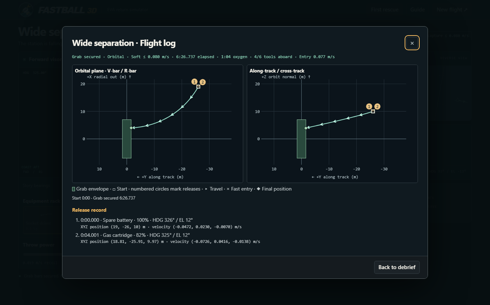

# Fastball 3D · Local prototype review

Open [index.html](index.html) and select **Begin flight** for a live manual opening or **First rescue** for Tommi’s guided return. This is a pre-0.1 development build based on `prototype-baseline`.

## Cockpit and flight rules

The selector, six rack slots, recoil, remaining delta-v, slider and Throw sit in the forward visor panel. Released tools retain their slots. Manual time begins before the first aim change. Pause, a hidden tab and the guide or setup cancel pending cockpit gestures. Manual flight resumes explicitly. Story permits staged and paused lineup and resumes at 1× on release.

The table gives rounded browser measurements in CSS pixels during a live manual flight. Coordinates start at the top-left of the viewport. The tests also check the centre hit point, all six slots, keyboard focus, horizontal overflow and the coast after release. The cockpit uses normal document flow throughout.

| CSS viewport | Visor top–bottom | Rack slot width × height | Power width × height | Throw top–bottom | Coast advice bottom |
| --- | ---: | ---: | ---: | ---: | ---: |
| 1440 × 950 | 190–532 | 139 × 78 | 550 × 32 | 668–712 | 490 |
| 1366 × 768 | 188–464 | 132 × 78 | 525 × 32 | 601–645 | 454 |
| 390 × 844 | 188–382 | 109 × 44 | 166 × 32 | 520–564 | 702 |
| 844 × 390 | 95–222 | 78 × 48 | 305 × 25 | 299–354 | 255 |

The 24 browser cases ran at each of those four sizes. They cover all three named starts under both flight models and both capture rules, Story lineup and replay, keyboard and pointer controls, a slider gesture spanning pause, a held key, duplicate clicks, dialogs and tab visibility. The manual straight-back case uses in-visor drag strokes on the named starts and eight seed numbers from each random family.

## First rescue and course display

The original Tether separation still returns in 346.49 simulated seconds with a 95% face-away battery in Straight-Line. The same release misses the envelope by 4.17 m in Orbital. A face-away wrench pouch at full power still finishes 3.52 m short in Straight-Line. Story uses the tested 3D battery, shows its forward departure and the opposite suit recoil, and pauses when the original clearance has halved. The follow-on lessons use a real light-tool correction on Lateral drift, a brake along measured drift before an excessive-speed entry, and a correction to the curved Orbital return. Every pitch spends stock equipment. A capture with the original power drill aboard earns **Upmass Hero**.

A straight coast viewed from the suit projects to a single bearing, including on an oblique flyby. The cameras use an end-on ring there, an off-screen indication when needed, and spaced arrowheads where curvature separates time samples. The coast readout gives the miss side, time and clearance even if the marker leaves a camera. The browser cases exercise closure, recession, an oblique miss, a curve leaving the frame and each camera looking both along and opposite the path. Whether those cues make correction direction intuitive is an open playtest question.

## Flight history

Both panes share a scale and station-centred axes. Along-track +Y points left in both. Radial +X points up in the orbital pane and orbit-normal +Z points up in the cross-track pane. The green rectangle shows the full envelope. Release numbers have leader lines so near-coincident throws can be distinguished.

The browser cases reconstruct a 3 m cross-track miss whose first projection crosses the station, a curved soft Orbital return, a fast entry followed by a successful soft grab, and oxygen expiry. Checks compare release positions and times, replay endpoints and event times at 1× and 30×. The fast-pass fixture enters at 0.116 m/s with two tools already spent. The example below is a separate Wide separation flight with the full rack and two actual releases four seconds apart.

## Shortcut comparison

Each count is successful flights out of 128. The two sets use the same sequence of seed numbers starting at decimal 104729. Plain hexadecimal seeds retain the original distribution. Newly generated `D-` seeds mix gentler separations with faster transverse crossings. The constructor checks an actual one- or two-throw soft route in each model. The change is confined to generated initial states.

| Flight set and model | Rule | Face away | Manual straight back | Repeat straight back | Add drift brake | Planned |
| --- | --- | ---: | ---: | ---: | ---: | ---: |
| Original Straight-Line | Any | 80 | 79 | 128 | 80 | 128 |
| Original Straight-Line | Soft | 57 | 56 | 57 | 80 | 128 |
| Original Orbital | Any | 49 | 49 | 124 | 49 | 128 |
| Original Orbital | Soft | 27 | 27 | 27 | 49 | 128 |
| New Straight-Line | Any | 11 | 11 | 30 | 11 | 128 |
| New Straight-Line | Soft | 1 | 1 | 1 | 11 | 128 |
| New Orbital | Any | 5 | 5 | 34 | 5 | 128 |
| New Orbital | Soft | 1 | 1 | 1 | 5 | 128 |

**Face away** uses the 95% battery immediately. **Manual straight back** allows 12 live seconds for a slew and rounds to the visor’s 0.25° grid. **Repeat straight back** uses the 95% battery and re-aims toward the opposite station bearing with the drill and pouch at 60 and 120 seconds if needed. **Add drift brake** starts with the face-away battery and uses the drill along measured velocity 18 seconds before a predicted fast entry. **Planned** solves for tool, bearing and power with access to the full 3D state.

| Named opening | Rule | Face away / manual | Repeated | With brake | Planned |
| --- | --- | --- | --- | --- | --- |
| Tether separation | Any | Straight-Line | Both | Straight-Line | Both |
| Tether separation | Soft | Straight-Line | Straight-Line | Straight-Line | Both |
| Lateral drift | Any | Neither | Both | Neither | Both |
| Lateral drift | Soft | Neither | Neither | Neither | Both |
| Wide separation | Any | Neither | Straight-Line | Neither | Both |
| Wide separation | Soft | Neither | Neither | Neither | Both |

On the new set, the soft planner used one throw on 67 Straight-Line and 60 Orbital openings, and two throws on the remaining 61 and 68. It also found soft routes on all 128 after 30 live seconds of initial drift in either model. With errors up to 10° and 10 power points, the opening plan alone won 77/128 soft flights in each model. One opportunity to replan raised those figures to 124/128 Straight-Line and 128/128 Orbital. The original 96-case fast-entry exercise retained 96/96 nominal brakes and 96/96 nominal post-pass returns in both models. Perturbed post-pass returns succeeded on 94/96 Straight-Line and 88/96 Orbital cases.

## Human playtest gaps before 0.1

No human pilots flew this development build during verification. The balance harness measures reachable routes under specified timing and aiming assumptions. The browser checks exercise DOM input in Chromium at fixed CSS sizes. Real touch ergonomics, browser chrome, device safe areas and assistive-technology navigation still need hands-on testing.

- Give a first-time pilot a manual flight before showing Story. Record time to the first pitch, whether they find the aft camera, and whether they can select, aim, adjust and release without scrolling on their device.
- On an oblique and an Orbital miss, ask the pilot to call the side of the miss and whether closest approach is ahead or behind. Record when they first identify it and the correction direction they choose.
- On a failed trim, record oxygen, remaining tools and remaining delta-v at recognition and release. That distinguishes late recognition from a wrong bearing or insufficient impulse.
- Show a soft fast pass and a two-pane log with a cross-track miss. Record whether the pilot understands that the first flight remains recoverable and can explain why the second missed.
- Compare the original and new random families on the same device. The new geometry reduces fixed-recipe wins and increases dependence on a course correction. Human difficulty and the discoverability of that correction still need review.
